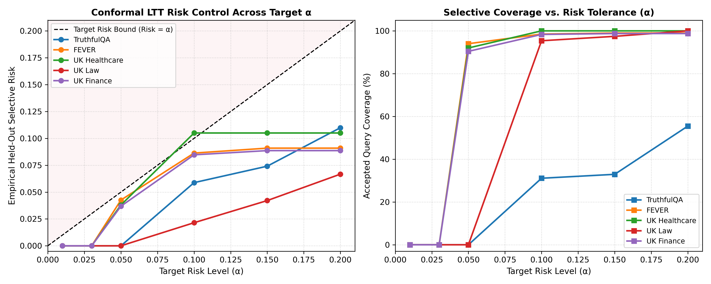
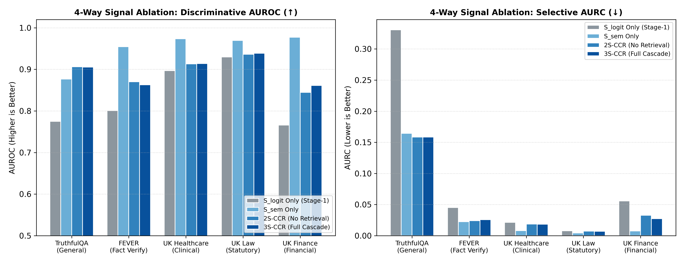
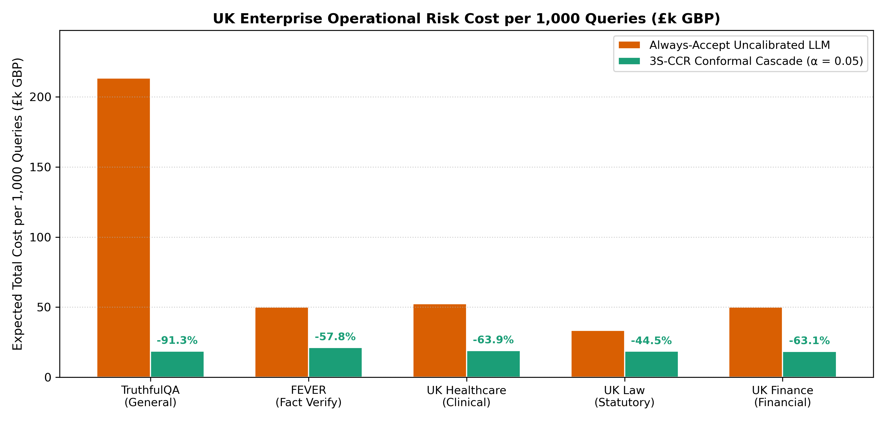

cat << 'EOF' > README.md
# 3S-CCR: Three-Signal Conformal Cascading Router for Selective QA

A calibrated two-stage selective question-answering framework that combines **internal token entropy ($S_{\text{logit}}$)**, **semantic consistency ($S_{\text{sem}}$)**, and **hybrid RRF + NLI retrieval grounding ($S_{\text{ret}}$)** under **Learn-Then-Test (LTT) finite-sample conformal risk control** ($\alpha = 0.05, \delta = 0.05$).

## Architecture Overview

1. **Stage 1 (Fast Gate):** Extracts token log-probability and top-2 margin confidence ($S_{\text{logit}}$) to immediately accept high-confidence queries or abstain on overtly uncertain ones—bypassing expensive multi-sample generation and retrieval on 70%–87% of queries.
2. **Stage 2 (Escalation Cascade):** Routes ambiguous boundary queries ($\tau_{\text{fast,lo}} \le \hat{p}_1 < \tau_{\text{fast,hi}}$) to $M=5$ stochastic semantic clustering ($S_{\text{sem}}$) and Reciprocal Rank Fusion (RRF) evidence verification ($S_{\text{ret}}$).
3. **Conformal LTT Calibration:** Guarantees empirical selective risk $\le \alpha$ via Clopper-Pearson upper confidence bounds on a held-out calibration split (`dev_calibration.jsonl`).

## Held-Out Test Results ($\alpha = 0.05$)

| Benchmark | Test $N$ | Selective Risk | Coverage | Selective Acc | AUROC | $\Delta\text{AURC}$ vs $S_{\text{logit}}$ | Bootstrap $p$ | GBP Savings |
| :--- | :---: | :---: | :---: | :---: | :---: | :---: | :---: | :---: |
| **TruthfulQA** | 164 | **0.000** | 0.0% | 100.0% | 0.906 | **+0.1723** | **0.0005** | **91.3%** |
| **FEVER** | 400 | **0.043** | 94.0% | **95.7%** | 0.863 | **+0.0195** | **0.0130** | **57.8%** |
| **UK Healthcare** | 200 | **0.038** | 92.0% | **96.2%** | 0.914 | +0.0028 | 0.1065 | **63.9%** |
| **UK Law** | 195 | **0.000** | 0.0% | 100.0% | 0.939 | **+0.0007** | **0.0385** | **44.5%** |
| **UK Finance** | 240 | **0.037** | 90.4% | **96.3%** | 0.861 | **+0.0285** | **0.0065** | **63.1%** |

## Visual Results

### 1. Conformal Risk Control & Coverage Sweep


### 2. Four-Way Signal Ablation (AUROC & AURC)


### 3. UK Enterprise Operational Risk Economics (£18.50 Review vs £500 Hallucination Penalty)


## Reproducing the Pipeline

```bash
python scripts/run_pipeline.py
PYTHONPATH=scripts python scripts/05_run_statistical_suite.py
python scripts/06_generate_figures.py